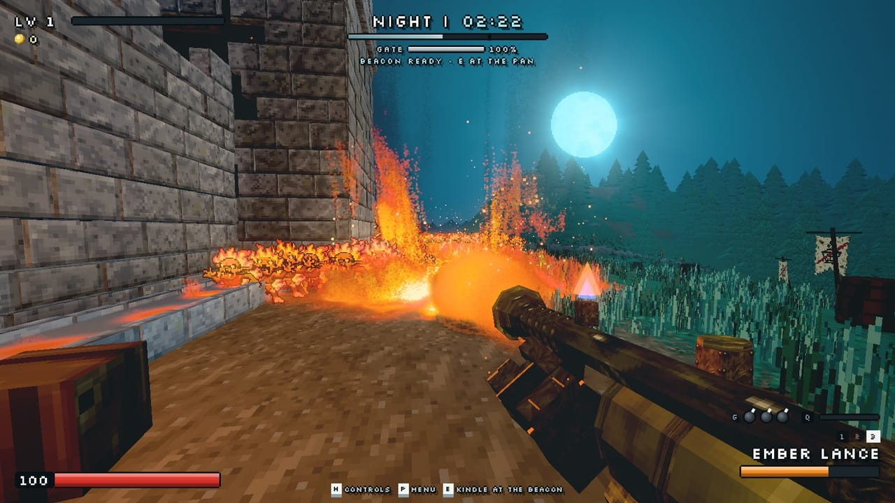
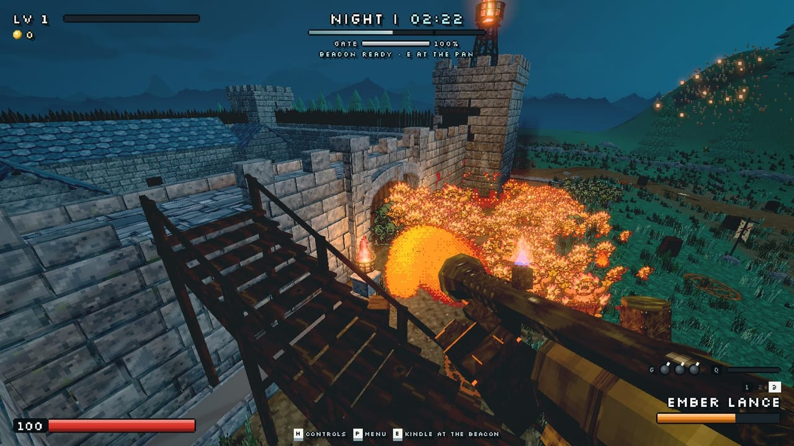
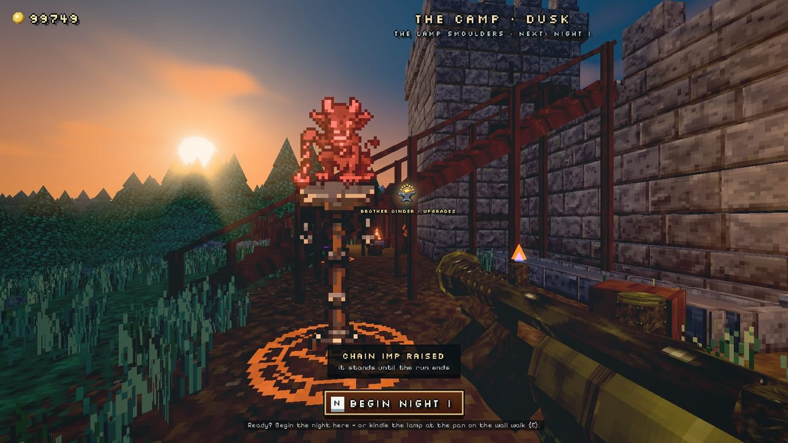

<p align="center">
  <a href="https://valleyward.app"></a>
</p>

<h1 align="center">VALLEYWARD</h1>

<p align="center"><b>A browser horde survivor where the fire is a plug-in. Bring your own.</b></p>

<p align="center">
  Hold a hilltop keep through ten nights against thousands of pixel goblins, with a real-time fluid fire that lights the
  world and really burns the horde. The fire comes from <a href="https://github.com/lethehaiau/firewraith">Firewraith</a>
  modules, so you can swap it for one you wrote.
</p>

<p align="center">
  <a href="https://valleyward.app"></a>
  <a href="https://github.com/lethehaiau/firewraith"></a>
  <a href="https://doi.org/10.5281/zenodo.24364837"></a>
  
  
  <a href="ASSET-LICENSES.md"></a>
</p>

<p align="center">
  <a href="https://valleyward.app"><b>Play now</b></a> ·
  <a href="#bring-your-own-fire">Bring your own fire</a> ·
  <a href="#run-it-locally">Run it locally</a> ·
  <a href="docs/DEVELOPING.md">Developing</a> ·
  <a href="docs/DESIGN.md">Design</a> ·
  <a href="#licence">Licence</a>
</p>

<table>
  <tr>
    <td width="25%" valign="top">
      <b>Play</b><br>
      Ten nights, thousands of goblins, the Ash Troll and the Rainmother. Spray the Ember Lance, kindle the beacon, burn
      the horde. A run ends when you fall; upgrades stay.
    </td>
    <td width="25%" valign="top">
      <b>Swap the fire</b><br>
      The fire is a <a href="https://github.com/lethehaiau/firewraith">Firewraith</a> module. Add
      <code>?firemod=&lt;id&gt;</code> to the URL to load another one; the game boots WebGL2 or WebGPU to match it.
    </td>
    <td width="25%" valign="top">
      <b>Build your own</b><br>
      A 2D or 3D grid, particles, SPH, compute shaders: anything that runs in a browser. One folder, one catalog line,
      and your fire burns real goblins.
    </td>
    <td width="25%" valign="top">
      <b>Measure it</b><br>
      The game shows what your module costs while you play (<code>__ew.perf().fire</code>), against a budget of about
      4.5 ms of GPU time per frame at 1080p.
    </td>
  </tr>
</table>

Press **P**, choose WebGL2 or WebGPU under **Renderer**, then confirm to reload with that renderer. Under **Fire module**,
pick another fire from [Firewraith](https://github.com/lethehaiau/firewraith), such as the Curved Volume Lance (WebGL2).

## Bring your own fire

VALLEYWARD is a playground for **real-time volumetric fire in the browser**. The challenge: fire that looks alive,
spreads, lights a whole night scene and decides what burns, inside a game frame, on a laptop.

The reference fire, Firewraith's `classic` module, is a 2D GPU grid fluid drawn as a ray-marched 2.5D volume. This is
what it costs today, on an Apple M4 at 1080p on quality `high`:

| | GPU time per frame |
| --- | ---: |
| `classic`, pixel-art style (`?fire=hybrid`, the default) | **1.83 ms** |
| `classic`, smooth style (`?fire=smooth`) | 4.09 ms |
| The fire's budget in the game | ≈ 4.5 ms |
| The whole game uncapped, median frame across the measured scenes (Night I: ≈ 4,000 goblins and fire) | 4.4–6.8 ms |

**Beat it, or make it more beautiful.** Some directions to try:

- a true 3D grid on WebGPU compute, with smoke that rolls over the walls;
- particle fire with GPU sorting, or SPH flames that pour like the oil they burn;
- temporal reprojection or upsampling, so a cheaper sim looks smoother;
- a Lance that sprays a real liquid arc, with drips and splashes.

**A module in one screen** (the full API is [Firewraith's `docs/API.md`](https://github.com/lethehaiau/firewraith/blob/main/docs/API.md)):

```js
export const info = { id: 'my-fire', name: 'My fire', version: '0.1.0', api: 1, backend: 'webgl2', slots: ['lance'] };

export async function create(host) {
  // host.renderer: the game's three.js renderer; host.world: ground height, walls, the Lance's physics, …
  return {
    lance(state) { /* { on, origin, dir, range, hue, landing } */ },
    update(dt, { rain }) { /* simulate */ },
    render(renderer, { colorTex, depthTex, camera, target, width, height }) { /* scene + your fire → target */ },
    reset() {}, dispose() {},
  };
}
```

A `ground` module also receives the game's events (firebombs, Lance landings, burning goblins, water) and may return a
gameplay grid, so **your fire decides what burns**, and a light map, so it lights the world.

**From idea to the live game:**

1. Write your module in Firewraith (`modules/<id>/`, plus one line in `modules/catalog.js`), or in your own repo.
2. Play it locally: run this game on your Firewraith checkout and open `http://127.0.0.1:5350/?firemod=<id>`, or load
   a module from any local dev server with `?lance=http://localhost:5173/src/index.js`.
3. Open a pull request on Firewraith. The checks run on every PR, and a maintainer reviews the code.
4. Once merged and released, your module is playable at `https://valleyward.app/?firemod=<id>`, with your name on it.

The step-by-step guide is **[Firewraith's CONTRIBUTING.md](https://github.com/lethehaiau/firewraith/blob/main/CONTRIBUTING.md)**.
Try the two reference modules now: [`?firemod=classic`](https://valleyward.app/?firemod=classic) (WebGL2) and
[`?firemod=classic-webgpu`](https://valleyward.app/?firemod=classic-webgpu) (WebGPU). A module that fills one slot
plays beside the reference module, as in
[`?firemod=lance-curved-volume`](https://valleyward.app/?firemod=lance-curved-volume) (Curved Volume Lance over the
classic ground fire).

<p align="center">
  
  
</p>

## Run it locally

```bash
git clone https://github.com/lethehaiau/valleyward.git && cd valleyward
npm ci          # Node 24; installs three.js and Firewraith
npm run dev     # http://127.0.0.1:5350/
```

- **Silent on purpose:** the game's audio is not in this repository (see [Licence](#licence)), so a clone plays silent.
  Everything else is here.
- **Tests:** `npm test` runs the deterministic sim, the bot over whole nights and campaigns, and the contracts, in Node.
  `npm run e2e` plays the game in headless Chrome. Both editions, the tools and every URL parameter are in
  [`docs/DEVELOPING.md`](docs/DEVELOPING.md).
- **Controls:** WASD to move, the mouse to aim, left click to fire (hold for the Lance), E at the beacon, P for the menu,
  H for every key.

## How it's built

- **three.js r186 in two editions:** WebGL2 (GLSL) and WebGPU (TSL), sharing everything but the shaders.
- **A deterministic simulation** in plain JavaScript (`src/sim/`), tested in Node, with a self-play bot that balances
  the campaign. Up to 10,000 goblins alive on `high`.
- **The fire** comes from Firewraith fire modules through a fire host (`src/fire/`), with a CPU fire grid as the
  referee and fallback.
- **Docs:** [design](docs/DESIGN.md) · [story](docs/STORY.md) · [art direction](docs/ART-DIRECTION.md) ·
  [core](docs/CORE.md) · [environment](docs/ENV.md) · [actors](docs/ACTORS.md) · [HUD and cinematics](docs/PRES.md) ·
  [audio](docs/AUDIO.md) · [WebGPU edition](docs/WEBGPU-PORT.md) · [decisions](docs/decisions/)

## Licence

- **Code and technical documentation:** [MIT](LICENSE).
- **Original game art and narrative content** (sprites, textures, UI art, key art and screenshots, the story and the
  game's lines): [CC BY-NC 4.0](https://creativecommons.org/licenses/by-nc/4.0/).
- **Fonts:** SIL Open Font License 1.1.
- **Audio:** generated with ElevenLabs under the authors' licence and kept out of this repository; the hosted game has
  it.

[ASSET-LICENSES.md](ASSET-LICENSES.md) lists which files each licence covers. To cite the fire engine, use Firewraith's
DOI, [10.5281/zenodo.24364837](https://doi.org/10.5281/zenodo.24364837) (v0.2.0).

<p align="center"><sub>Made by <a href="https://github.com/lethehaiau">Au Le</a></sub></p>
